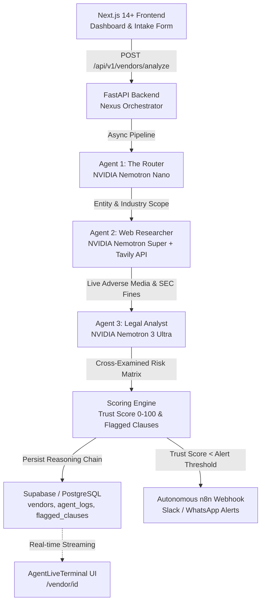

# Nexus Orchestrator — Multi-Agent "Zero-Touch Compliance Analyst" Platform

Nexus Orchestrator is a production-grade multi-agent LLM orchestration platform designed to eliminate the **10 to 15-hour vendor onboarding bottleneck**. It ingests vendor Master Service Agreements (MSAs), orchestrates specialist AI agents to analyze risk and reputation against real-world adverse media, calculates an objective **Trust Score (0-100)**, logs the reasoning chain into Supabase / PostgreSQL, and autonomously triggers **n8n webhooks** for instant Slack/WhatsApp compliance escalation.

---

## 🏗️ System Architecture



---

## 🤖 Multi-Agent Specialized Roles

| Agent | Model Engine | Core Mission |
|---|---|---|
| **The Router** | **NVIDIA Nemotron Nano** | Low-latency entity extraction, legal name resolution, and industry sector classification. |
| **The Web Researcher** | **NVIDIA Nemotron Super + Tavily API** | Autonomous OSINT web search for adverse media, lawsuits, SEC enforcement, FTC fines, and data breaches. |
| **The Legal Analyst** | **NVIDIA Nemotron 3 Ultra** | Heavy-reasoning contract auditor cross-referencing contract provisions against live reputation findings. |
| **The Orchestrator** | **FastAPI + Async Worker** | Coordinates pipeline execution, persists chronologically ordered `agent_logs`, and fires n8n webhooks. |

---

## 🎯 Target Risk Domains & Severity Matrix

The Legal Analyst categorizes all identified liabilities into 4 strict domains:
1. `INFORMATION_SECURITY`: Data breach liability caps, lack of SOC 2 audit rights, inadequate breach notification windows.
2. `FINANCIAL_RISK`: Aggressive auto-renewals, uncapped price increases, unilateral dispute reserve withholdings.
3. `LEGAL_LIABILITY`: One-sided indemnification carve-outs, sole remedy clauses, foreign dispute jurisdictions.
4. `REGULATORY_COMPLIANCE`: SEC Rule 10-K cyber reporting disclaimers, GDPR Article 28 non-compliance, FTC consent decrees.

---

## 🚀 Quickstart & Running Locally

### 1. Backend (FastAPI + Python 3.11+)

```bash
cd backend
python3 -m venv venv
source venv/bin/activate
pip install -r requirements.txt
uvicorn main:app --host 0.0.0.0 --port 8000
```

### 2. Frontend (Next.js 14 App Router + Tailwind + shadcn)

```bash
cd frontend
npm install
npm run dev
```

Open [http://localhost:3000](http://localhost:3000) in your browser.

---

## ⚙️ Environment Variables Template

### Backend (`backend/.env`)
```bash
PORT=8000
FRONTEND_URL=http://localhost:3000

# Supabase (PostgreSQL) - Automatic fallback to SQLite if unconfigured
SUPABASE_URL=your_supabase_project_url
SUPABASE_KEY=your_supabase_service_role_key

# Nebius Token Factory (NVIDIA Nemotron Endpoints)
NEBIUS_API_KEY=your_nebius_api_key
NEBIUS_BASE_URL=https://api.studio.nebius.ai/v1/

# Model Configurations
ROUTER_MODEL=nvidia/llama-3.1-nemotron-70b-instruct
RESEARCHER_MODEL=nvidia/llama-3.1-nemotron-70b-instruct
ANALYST_MODEL=nvidia/llama-3.1-nemotron-70b-instruct

# Tavily Search API
TAVILY_API_KEY=your_tavily_api_key

# n8n Webhook Settings
DEFAULT_WEBHOOK_URL=
DEFAULT_ALERT_THRESHOLD=70
```

### Frontend (`frontend/.env.local`)
```bash
NEXT_PUBLIC_API_BASE_URL=http://localhost:8000
```

---

## 🗄️ PostgreSQL Database Schema (`schema.sql`)

```sql
CREATE EXTENSION IF NOT EXISTS "uuid-ossp";

CREATE TABLE public.vendors (
    id UUID PRIMARY KEY DEFAULT uuid_generate_v4(),
    created_at TIMESTAMPTZ NOT NULL DEFAULT NOW(),
    updated_at TIMESTAMPTZ NOT NULL DEFAULT NOW(),
    name TEXT NOT NULL,
    status TEXT NOT NULL DEFAULT 'PENDING',
    contract_text TEXT,
    trust_score INTEGER,
    reputation_summary TEXT,
    overall_reasoning TEXT,
    industry TEXT,
    legal_entity_name TEXT,
    is_alert_triggered BOOLEAN DEFAULT FALSE,
    error_message TEXT
);

CREATE TABLE public.agent_logs (
    id UUID PRIMARY KEY DEFAULT uuid_generate_v4(),
    vendor_id UUID NOT NULL REFERENCES public.vendors(id) ON DELETE CASCADE,
    created_at TIMESTAMPTZ NOT NULL DEFAULT NOW(),
    agent_name TEXT NOT NULL,
    log_message TEXT NOT NULL,
    metadata JSONB
);

CREATE TABLE public.flagged_clauses (
    id UUID PRIMARY KEY DEFAULT uuid_generate_v4(),
    vendor_id UUID NOT NULL REFERENCES public.vendors(id) ON DELETE CASCADE,
    domain TEXT NOT NULL,
    severity TEXT NOT NULL,
    clause_text TEXT NOT NULL,
    agent_reasoning TEXT NOT NULL
);

CREATE TABLE public.app_settings (
    id UUID PRIMARY KEY DEFAULT uuid_generate_v4(),
    webhook_url TEXT DEFAULT '',
    alert_threshold INTEGER DEFAULT 70,
    updated_at TIMESTAMPTZ NOT NULL DEFAULT NOW()
);
```

---

## 📡 API Endpoints

- `POST /api/v1/vendors/analyze`: Ingests contract text and vendor name, spawns background multi-agent pipeline.
- `GET /api/v1/vendors`: Returns list of all vendors with status and trust scores.
- `GET /api/v1/vendors/{vendor_id}`: Returns complete vendor dossier, reputation report, and flagged clauses.
- `GET /api/v1/vendors/{vendor_id}/logs`: Returns chronological agent logs for real-time streaming.
- `POST /api/v1/extract`: Parses uploaded PDF or TXT contract files.
- `GET /api/v1/settings`: Fetches n8n webhook URL and alert threshold.
- `POST /api/v1/settings/webhook`: Updates n8n webhook URL and alert threshold.
- `POST /api/v1/settings/test-webhook`: Dispatches diagnostic alert payload to verify webhook connectivity.
