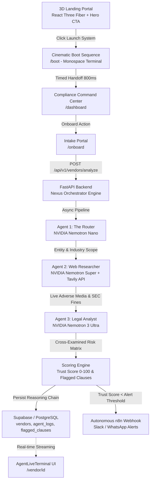

# Nexus Orchestrator — Multi-Agent "Zero-Touch Compliance Analyst" Platform

Nexus Orchestrator is a production-grade multi-agent LLM orchestration platform designed to eliminate the **10 to 15-hour vendor onboarding bottleneck**. It ingests vendor Master Service Agreements (MSAs), orchestrates specialist AI agents to analyze risk and reputation against real-world adverse media, calculates an objective **Trust Score (0-100)**, logs the reasoning chain into Supabase / PostgreSQL, and autonomously triggers **n8n webhooks** for instant Slack/WhatsApp compliance escalation.

---

## 🏗️ System Architecture & Visual Flow



---

## 🌟 Application Pages & Routes

1. **`/` (3D Interactive Landing Page)**:
   - React Three Fiber 3D Canvas rendering a futuristic cyber grid, glowing floating particles, and rotating geodesic wireframe core reacting to mouse parallax.
   - High-contrast Hero section with magnetic "Launch System" CTA button featuring glowing border sweep.
   - Live metrics showcase and 3-agent swarm telemetry preview.
2. **`/boot` (Cinematic Boot Sequence)**:
   - Full-screen dark terminal with monospace typography (`JetBrains Mono`).
   - Animated typing simulation with blinking cursor:
     - `> Initializing Nexus Orchestrator...`
     - `> System Status: OK`
     - `> Connecting to secure mainframe...`
     - `> Loading console...`
     - `> 103 automated tests, all passing.`
   - Synchronized telemetry progress bar (0% → 100%).
   - Automatic 800ms hold followed by a smooth fade-out / slide-up handoff to `/dashboard`.
3. **`/dashboard` (Command Center)**:
   - Top metrics StatCards (Total Ingested Vendors, High Risk & Alerted, Average Score, Legal Hours Saved).
   - Interactive VendorDataTable with live search, status filters, sorting, and direct dossier review.
4. **`/onboard` (Vendor Contract Intake)**:
   - Drag-and-drop PDF and TXT contract upload with automatic text extraction.
   - 1-Click Benchmark MSA Templates (Apex Cloud Critical Risk, PayGate Moderate Risk, Nordic Sentinel Safe).
   - Form validation powered by Zod (`VendorUploadSchema`).
5. **`/vendor/[id]` (Vendor Compliance Dossier)**:
   - Circular animated `ScoreGauge` with visual risk badges and domain breakdowns.
   - Real-time `AgentLiveTerminal` streaming chronological reasoning logs.
   - `ClauseHighlighterCard` with domain and severity filters (InfoSec, Financial, Legal, Regulatory).
   - Live Nemotron Super + Tavily OSINT reputation card.
6. **`/settings` (Configuration & Integrations)**:
   - n8n Webhook URL configuration with test dispatch button.
   - Trust Score alert threshold slider (default 70).
   - AI infrastructure health telemetry.

---

## 🤖 Multi-Agent Specialized Roles

| Agent | Model Engine | Core Mission |
|---|---|---|
| **The Router** | **NVIDIA Nemotron Nano** | Low-latency entity extraction, legal name resolution, and industry sector classification. |
| **The Web Researcher** | **NVIDIA Nemotron Super + Tavily API** | Autonomous OSINT web search for adverse media, lawsuits, SEC enforcement, FTC fines, and data breaches. |
| **The Legal Analyst** | **NVIDIA Nemotron 3 Ultra** | Heavy-reasoning contract auditor cross-referencing contract provisions against live reputation findings. |
| **The Orchestrator** | **FastAPI + Async Worker** | Coordinates pipeline execution, persists chronologically ordered `agent_logs`, and fires n8n webhooks. |

---

## 🎯 Target Risk Domains & Severity Matrix

The Legal Analyst categorizes all identified liabilities into 4 strict domains:
1. `INFORMATION_SECURITY`: Data breach liability caps, lack of SOC 2 audit rights, inadequate breach notification windows.
2. `FINANCIAL_RISK`: Aggressive auto-renewals, uncapped price increases, unilateral dispute reserve withholdings.
3. `LEGAL_LIABILITY`: One-sided indemnification carve-outs, sole remedy clauses, foreign dispute jurisdictions.
4. `REGULATORY_COMPLIANCE`: SEC Rule 10-K cyber reporting disclaimers, GDPR Article 28 non-compliance, FTC consent decrees.

---

## 🚀 Quickstart & Running Locally

### 1. Package Installation

```bash
# Frontend
cd frontend
npm install framer-motion three @types/three @react-three/fiber@^8.16.8 @react-three/drei@^9.106.0 --legacy-peer-deps
npm install

# Backend
cd ../backend
python3 -m venv venv
source venv/bin/activate
pip install -r requirements.txt
```

### 2. Launching the Platform

```bash
# Terminal 1: FastAPI Backend
cd backend
./venv/bin/uvicorn main:app --host 0.0.0.0 --port 8000

# Terminal 2: Next.js Frontend
cd frontend
npm run dev
```

Open [http://localhost:3000](http://localhost:3000) for the 3D Landing Page, click **"Launch System"** to experience the cinematic boot sequence, or go directly to [http://localhost:3000/dashboard](http://localhost:3000/dashboard).
